# OdontoAR

> **UPX — Realidade Aumentada · Equipe Aura Works**
> App iOS que coloca uma arcada dentária 3D em tamanho real sobre a mesa para estudantes de
> Odontologia explorarem coroa, raiz, osso alveolar e nervos, com nomes em português e notação FDI.


---

## 1. Identificação do Projeto

| Item | Informação |
|---|---|
| **Projeto** | OdontoAR — arcada dentária em Realidade Aumentada |
| **Equipe** | Aura Works |
| **Curso** | Engenharia da Computação |
| **Instituição** | Facens (UniFacens) |
| **Disciplina** | UPX — Realidade Aumentada |
| **Professor** | Daniel Ohata |
| **Semestre** | 8º semestre (2026.2) |

### Integrantes

| Nome | RA | Responsabilidade |
|---|---|---|
| Vinicius Alegre de Oliveira | 211902 | Tech lead: arquitetura, programação C#, integração AR Foundation/ARKit e build iOS |
| Guilherme Dias | 235128 | Scrum Master: organização das tarefas, acompanhamento do cronograma |
| Leonardo Vergilio Luz | 234674 | Desenvolvedor Unity |
| Bruno Carvalho | 235537 | Desenvolvedor UI/UX: design da interface |

---

## 2. Visão Geral

Estudantes de Odontologia aprendem a anatomia dental em atlas, peças de resina e manequins. Esses
materiais não mostram ao mesmo tempo o que está **dentro** do osso (raízes e nervos) e o que está fora
(coroas), e as peças físicas são poucas e ficam no laboratório.

O **OdontoAR** é um app para iPhone que usa a câmera para detectar uma mesa e coloca sobre ela uma
arcada dentária 3D **em tamanho real**. O aluno anda em volta do modelo, gira, amplia, abre a boca,
liga e desliga camadas (coroa, raiz, osso alveolar e nervos) e toca em qualquer dente para ver o nome
anatômico e o número FDI ("Primeiro molar inferior esquerdo — 36").

A Realidade Aumentada é o centro da solução: o ARKit (via AR Foundation) detecta o plano da mesa,
ancora o modelo no mundo real e, nos iPhones com LiDAR, faz a mão do aluno passar na frente da arcada
(oclusão). O app funciona offline e registra o uso (tempo, camadas e estruturas tocadas) para a
pesquisa, identificado só por um código de participante.

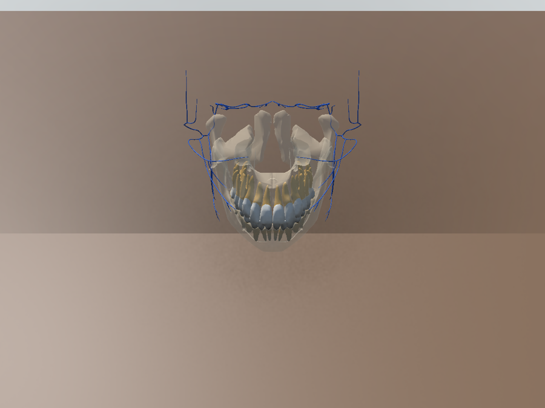

---

## 3. Problema

- **Contexto:** a anatomia dental é base de todas as disciplinas clínicas da Odontologia; o aluno
  precisa reconhecer cada dente, sua posição na arcada, a relação coroa/raiz/osso e a notação FDI.
- **Situação atual:** o estudo usa imagens 2D (atlas, slides) e modelos físicos de resina ou
  manequins, disponíveis em número limitado e só no laboratório.
- **Dificuldade:** imagens 2D não dão noção de profundidade; modelos físicos não deixam "tirar" o
  osso para ver as raízes nem mostram o nome de cada estrutura; não dá para estudar em casa.
- **Público afetado:** estudantes dos primeiros períodos de Odontologia e professores que precisam
  de material de apoio.
- **Impacto:** mais tempo para memorizar posições e nomes, dificuldade em relacionar o que está
  visível na boca com o que está dentro do osso, e dependência do horário do laboratório.

---

## 4. Objetivos

### 4.1 Objetivo Geral

Desenvolver uma prova de conceito (POC) de app de Realidade Aumentada para iOS que permita a
estudantes de Odontologia explorar uma arcada dentária 3D em tamanho real sobre uma superfície
física, com camadas anatômicas e identificação das estruturas em notação FDI.

### 4.2 Objetivos Técnicos

- Configurar um projeto Unity 6 (URP) com AR Foundation e ARKit, com build iOS por linha de comando.
- Detectar superfícies horizontais e posicionar a arcada em tamanho real com uma âncora de mundo.
- Permitir girar, inclinar, ampliar (0,5×–4×), restaurar a vista e reposicionar por gestos.
- Alternar arcada superior, inferior ou ambas e ajustar a abertura da boca (0°–30°, em torno da ATM).
- Exibir e ocultar as camadas coroa, raiz, osso e nervos, com transparência.
- Selecionar uma estrutura por toque e exibir nome em português e código FDI.
- Ocultar o modelo atrás da mão do usuário com o LiDAR (oclusão).
- Registrar o uso em JSON no aparelho, sem dados pessoais, e exportá-lo.
- Manter ≥ 30 FPS no iPhone de teste e funcionar sem internet.
- Verificar o sistema com o checklist de testes ([`TESTES.md`](docs/documents/TESTES.md)).

---

## 5. Público-Alvo

- **Perfil:** estudantes de graduação em Odontologia, principalmente das disciplinas de anatomia
  e escultura dental; secundariamente, professores que querem mostrar a arcada em aula.
- **Contexto de uso:** estudo individual ou em dupla, sobre uma mesa ou carteira, em sala de aula,
  biblioteca ou em casa.
- **Necessidades:** ver a relação coroa/raiz/osso, aprender os nomes e a numeração FDI, estudar sem
  depender do laboratório.
- **Familiaridade tecnológica:** usam smartphone no dia a dia, mas não necessariamente conhecem RA;
  por isso o app guia a busca da mesa e traz uma tela de ajuda com os gestos (RNF04).
- **Limitações:** precisam de um iPhone compatível com ARKit (iPhone XS ou mais novo, iOS 15+).

---

## 6. Funcionalidades

| ID | Funcionalidade | Descrição | Status |
|---|---|---|---|
| RF01 | Visualizar arcada em RA | Arcada 3D sobreposta à imagem da câmera, em tamanho real | ✅ |
| RF02 | Posicionar na superfície | Retículo sobre a mesa detectada; toque ancora a arcada; "Reposicionar" volta à busca | ✅ |
| RF03 | Selecionar arcada | Superior, inferior ou ambas | ✅ |
| RF04 | Rotacionar | 1 dedo: horizontal gira sobre a mesa, vertical inclina sem limite; 2 dedos rodam | ✅ |
| RF05 | Alterar escala | Pinça de 0,5× a 4× do tamanho real, mantendo a arcada apoiada na mesa | ✅ |
| RF06 | Abertura da boca | Slider de 0° a 30° em torno da ATM | ✅ |
| RF07 | Restaurar vista | Volta giro, inclinação e zoom ao padrão | ✅ |
| RF08 | Camadas | Coroa, raiz, osso e nervos; coroa e raiz ficam translúcidas com osso ou nervos visíveis | ✅ |
| RF09 | Selecionar estrutura | Toque mostra contorno ciano e cartão com nome, FDI e camada | ✅ |
| RF10 | Registro de uso | Sessões, camadas e estruturas em JSON, exportado pela folha de compartilhamento do iOS | ✅ |
| — | Oclusão com LiDAR | A mão passa na frente da arcada (só em iPhones com LiDAR) | ✅ |
| — | Recuperação do rastreamento | Se o ARKit reinicia o mundo, o app avisa e volta à busca da mesa | ✅ |
| — | Estabilidade da arcada ao mover o iPhone | Arcada ainda "nada" levemente com o movimento do aparelho | 🚧 |
| — | Polpa e terceiros molares | O modelo do Z-Anatomy não inclui; a 4ª camada virou "nervos" | ❌ (na POC) |
| — | Versão Android (ARCore) | O código usa AR Foundation, mas o alvo não foi configurado nem testado | ⬜ |

**Legenda:** ✅ Implementado · 🚧 Em desenvolvimento · ⬜ Planejado · ❌ Cancelado

---

## 7. Requisitos Não Funcionais

| ID | Categoria | Requisito | Situação |
|---|---|---|---|
| RNF01 | Compatibilidade | Smartphones com RA (iOS e Android) | Parcial: só iOS na POC |
| RNF02 | Desempenho | ≥ 30 FPS com todas as camadas | 60 FPS médio, pior quadro ~31 FPS (iPhone 16 Pro Max) |
| RNF03 | Estabilidade | Modelo estável sobre a superfície com iluminação comum | Em verificação (seção 24) |
| RNF04 | Usabilidade | Uso sem treinamento, todos os textos em português do Brasil | Implementado; piloto com colegas pendente |
| RNF05 | Conectividade | Funciona offline; registros só no aparelho | Implementado (o app não usa rede) |
| RNF06 | Conteúdo | Modelo a partir de referência anatômica, validado por especialista | Modelo Z-Anatomy; revisão pendente |
| RNF07 | Privacidade | Registros sem dados pessoais, só o código do participante | Implementado |
| RNF08 | Hardware | iOS 15+, ARKit (iPhone XS ou mais novo); LiDAR opcional (só para oclusão) | Implementado |

---

## 8. Tecnologias Utilizadas

| Tecnologia | Versão | Utilização |
|---|---|---|
| Unity | 6000.6.4f1 | Motor e editor do app |
| Universal Render Pipeline | 17.6.0 | Renderização (câmera de RA, transparência, contorno) |
| C# | 9.0 (Unity 6) | Scripts do app, do Editor e testes |
| AR Foundation | 6.6.2 | Camada de RA: sessão, planos, raycast, âncoras, oclusão |
| Apple ARKit XR Plugin | 6.6.2 | Implementação do AR Foundation no iOS |
| XR Plugin Management | 4.7.0 | Ativa o ARKit no build iOS |
| Input System | 1.20.0 | Toques e gestos (`EnhancedTouch`) |
| uGUI + TextMeshPro | 2.6.0 | Interface |
| Unity Test Framework | 1.8.0 | 126 testes EditMode |
| Objective-C++ | — | Plugins nativos: permissão de câmera e compartilhamento |
| Xcode | 27.1 | Compilação, assinatura e instalação no iPhone |
| macOS | 27.0.1 | Sistema do computador de desenvolvimento |
| Git / GitHub | 2.53.0 / — | Controle de versão |
| Z-Anatomy (BodyParts3D) | — | Origem do modelo 3D (CC BY-SA 4.0) |
| Fontes Inter e JetBrains Mono | — | Tipografia (SIL OFL 1.1) |
| Claude Code | — | Assistente de programação usado no desenvolvimento |

---

## 9. Hardware Utilizado

| Equipamento | Modelo | Característica relevante | Utilização |
|---|---|---|---|
| Computador | Mac com Apple M5, 16 GB RAM, macOS 27.0.1 | Único sistema que gera e assina apps iOS | Desenvolvimento, build e instalação |
| Smartphone | Apple iPhone 16 Pro Max, iOS 27.0.1 | ARKit, câmera traseira e **LiDAR** | Testes da RA, oclusão e desempenho |

---

## 10. Arquitetura do Sistema

O app é local: não há servidor, API nem banco de dados. A interface e os gestos só escrevem numa classe
de estado pura (`ModelState`), e os componentes de visualização desenham a partir dela. O módulo de RA
conversa com o ARKit por meio do AR Foundation. Fonte do diagrama:
[`docs/diagrams/arquitetura.md`](docs/diagrams/arquitetura.md).

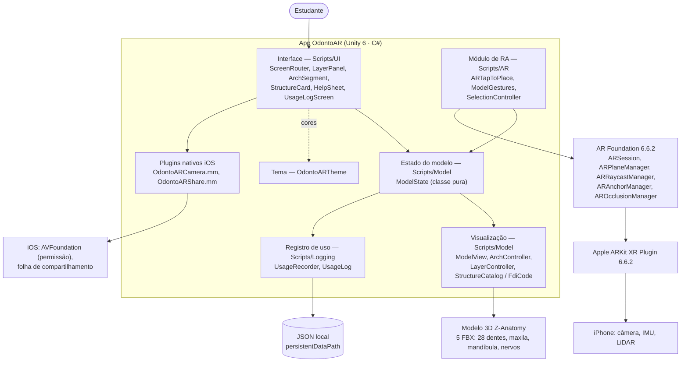

### Fluxo resumido

```text
Estudante → Interface (uGUI) → ModelState → Módulo de RA → AR Foundation → ARKit → câmera / IMU / LiDAR → mesa real
```

---

## 11. Funcionamento da Realidade Aumentada

### 11.1 Técnica utilizada

**Markerless com Plane Detection** (detecção de planos horizontais), **âncora de mundo** e
**oclusão de ambiente** por profundidade (LiDAR). Não há marcador nem imagem de referência: qualquer
mesa ou carteira serve.

### 11.2 Componentes do AR Foundation usados

| Componente | Papel no OdontoAR |
|---|---|
| `ARSession` | Inicia o ARKit e informa o estado do rastreamento (ex.: `InsufficientFeatures`) |
| `XR Origin` + `ARCameraManager` / `ARCameraBackground` | Mostra a câmera ao fundo e move a câmera virtual com o iPhone |
| `ARPlaneManager` | Detecta planos horizontais (a mesa) e continua refinando a altura deles |
| `ARRaycastManager` | Lança um raio do centro da tela contra os planos para posicionar o retículo |
| `ARAnchorManager` | Cria a âncora de mundo onde a arcada fica; o ARKit corrige a âncora quando refina o mapa |
| `AROcclusionManager` | Profundidade do ambiente com LiDAR ("Best"): a mão esconde a arcada |

### 11.3 Fluxo técnico

Fonte: [`docs/diagrams/fluxo-ra.md`](docs/diagrams/fluxo-ra.md).

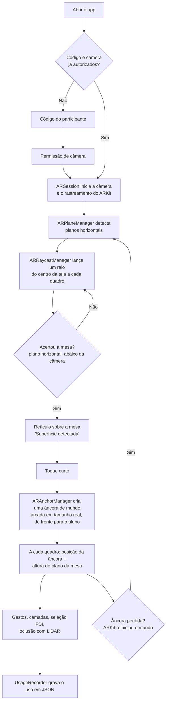

1. O `ARSession` liga a câmera e o ARKit começa a rastrear o iPhone (câmera + IMU).
2. O `ARPlaneManager` detecta planos horizontais. A tela mostra "Procurando superfície…".
3. A cada quadro, `ARTapToPlace` lança um raio do centro da tela (`ARRaycastManager`). Só aceita
   planos já detectados (`PlaneWithinPolygon`; fora do contorno, `PlaneWithinInfinity` até 2 m),
   voltados para cima e abaixo da câmera, o que descarta teto e parede.
4. O retículo aparece sobre a mesa ("Superfície detectada"). Um toque curto (que não seja pinça,
   arrasto nem toque em botão) posiciona a arcada.
5. A arcada nasce em tamanho real, nivelada pelo plano oclusal e de frente para o aluno, e é presa a
   uma **âncora de mundo** criada pelo `ARAnchorManager`. A altura acompanha o plano da mesa (±5 cm,
   suavizada), que o ARKit continua refinando.
6. A partir daí, gestos, camadas e seleção mudam o `ModelState`; o `ModelView` mantém a arcada apoiada
   na mesa em qualquer rotação e escala. Com LiDAR, o `AROcclusionManager` esconde a arcada atrás da mão.
7. Se a âncora some (o ARKit reinicia o mundo por falta de textura ou de luz), o app avisa "O
   rastreamento reiniciou. Procure a mesa de novo…" e volta ao passo 2.

### 11.4 Elementos virtuais

- arcada 3D: 28 dentes (coroa e raiz separadas), maxila, mandíbula e nervos;
- retículo de posicionamento e sombra de contato sob a arcada;
- contorno ciano na estrutura selecionada, com o resto esmaecido a 20%;
- cartão com nome em português, código FDI e camada;
- painel de camadas, seletor de arcada, slider de abertura e mensagens de status do rastreamento.

---

## 12. Estrutura do Projeto

```text
OdontoAR/
├── Assets/
│   └── _OdontoAR/            tudo o que a equipe produziu
│       ├── Scripts/
│       │   ├── AR/           posicionamento, gestos, seleção
│       │   ├── Model/        estado do modelo, arcadas, camadas, catálogo FDI
│       │   ├── UI/           telas, painéis, cartão
│       │   ├── Logging/      registro de uso (RF10)
│       │   ├── App/          preferências, permissão de câmera, compartilhamento
│       │   ├── Diagnostics/  FPS e log de rastreamento
│       │   └── Theme/        OdontoARTheme (tokens de cor e opacidade)
│       ├── Editor/           build, configuração iOS, geração de cena/UI, validador do modelo
│       ├── Plugins/iOS/      OdontoARCamera.mm, OdontoARShare.mm
│       ├── Models/           FBX do Z-Anatomy
│       ├── Materials/  Shaders/  Prefabs/  Scenes/  Data/  UI/
│       └── Tests/EditMode/   126 testes EditMode
├── Packages/                 manifest.json com as versões dos pacotes
├── ProjectSettings/          configuração do Unity (gerada por ProjectSetup)
├── docs/
│   ├── diagrams/             arquitetura, fluxo da RA, navegação, casos de uso (Mermaid)
│   ├── images/               telas e modelo 3D
│   └── documents/            plano, histórico, testes, instalação, auditoria, créditos
├── CLAUDE.md                 regras do projeto e comandos de build
├── .gitignore
└── README.md
```

### Pastas principais

| Pasta | Finalidade |
|---|---|
| `Assets/_OdontoAR/Scripts` | Código C# do app (assembly `OdontoAR`) |
| `Assets/_OdontoAR/Editor` | Scripts de Editor (menus `OdontoAR/...`) que geram cena, prefab, UI e build; nada é montado à mão |
| `Assets/_OdontoAR/Plugins/iOS` | Código nativo do iOS chamado pelo C# |
| `Assets/_OdontoAR/Models` | Modelo 3D (5 FBX) |
| `Assets/_OdontoAR/Scenes` | `AR.unity`, a única cena do app |
| `Assets/_OdontoAR/Tests/EditMode` | Testes automatizados do estado, FDI e registro |
| `docs/diagrams` | Diagramas técnicos |
| `docs/images` | Telas e imagens do modelo |
| `docs/documents` | Documentos complementares (ver seção 30) |

Pastas geradas pelo Unity (`Library/`, `Temp/`, `Logs/`, `UserSettings/`) e builds (`Builds/`) ficam
fora do repositório pelo `.gitignore`.

---

## 13. Principais Scripts

| Script | Responsabilidade |
|---|---|
| `AR/ARTapToPlace.cs` | Raycast contra os planos, retículo, âncora de mundo, altura da mesa e detecção de rastreamento reiniciado |
| `AR/ModelGestures.cs` | Gestos de 1 e 2 dedos: girar, inclinar, ampliar e rodar |
| `AR/SelectionController.cs` | Toque curto seleciona a estrutura; ignora camadas ocultas e prefere o dente atrás do osso |
| `Model/ModelState.cs` | Classe pura com arcada, abertura, rotação, escala, camadas e seleção (testada em EditMode) |
| `Model/ModelView.cs` | Aplica rotação e escala do estado e mantém a arcada apoiada na mesa |
| `Model/ArchController.cs` | Mostra a arcada escolhida e abre a mandíbula em torno da ATM |
| `Model/LayerController.cs` | Liga/desliga coroa, raiz, osso e nervos e ajusta a transparência |
| `Model/FdiCode.cs`, `StructureCatalog.cs` | Traduzem os nomes do Z-Anatomy para FDI e nomes em português |
| `Logging/UsageRecorder.cs`, `UsageLog.cs` | Gravam sessões, camadas e estruturas tocadas em JSON |
| `UI/ScreenRouter.cs` | Navegação entre as telas (abertura, código, permissão, RA, registro) |
| `UI/StructureCard.cs`, `LayerPanel.cs`, `ArchSegment.cs` | Cartão FDI, painel de camadas e seletor de arcada |
| `App/CameraPermission.cs` + `OdontoARCamera.mm` | Lê e pede a permissão de câmera direto no iOS |
| `App/ShareSheet.cs` + `OdontoARShare.mm` | Exporta o JSON pela folha de compartilhamento do iOS |
| `Theme/OdontoARTheme.cs` | Únicas cores e opacidades usadas no app |
| `Editor/ProjectSetup.cs` | Menu `OdontoAR/Configurar projeto iOS`: plataforma, ARKit, bundle id, textos de permissão |
| `Editor/ARSceneBuilder.cs`, `ARUIBuilder.cs` | Geram a cena `AR.unity`, o prefab da arcada e toda a interface |
| `Editor/BuildScript.cs`, `IOSPostProcess.cs` | Build iOS por linha de comando e ajustes no projeto Xcode |
| `Editor/ModelValidator.cs` | Aponta dentes sem FDI, sem coroa/raiz ou sem collider |

---

## 14. Dependências

Pacotes do Unity Registry (instalados automaticamente a partir de `Packages/manifest.json`):

```text
com.unity.xr.arfoundation            6.6.2
com.unity.xr.arkit                   6.6.2
com.unity.xr.management              4.7.0
com.unity.inputsystem                1.20.0
com.unity.render-pipelines.universal 17.6.0
com.unity.ugui                       2.6.0   (inclui TextMeshPro)
com.unity.test-framework             1.8.0
```

Recursos externos incluídos no repositório (não precisam de download):

- Modelo 3D: [Z-Anatomy](https://www.z-anatomy.com/) (BodyParts3D © DBCLS), CC BY-SA 4.0 —
  atribuição em [`CREDITOS.md`](docs/documents/CREDITOS.md) e na tela de ajuda do app.
- Fontes: [Inter](https://rsms.me/inter/) e [JetBrains Mono](https://www.jetbrains.com/lp/mono/), SIL OFL 1.1.

Nenhum pacote de terceiros nem SDK de rede.

---

## 15. Configuração do Ambiente

Passo a passo completo, incluindo assinatura com outro Apple ID:
[`docs/documents/INSTALACAO.md`](docs/documents/INSTALACAO.md).

### Pré-requisitos

- **Mac** (o build iOS só é possível no macOS);
- **Xcode** (testado com 27.1), aberto ao menos uma vez e selecionado (`xcode-select -p` deve mostrar
  `/Applications/Xcode.app/...`; só com as Command Line Tools o build falha em `actool`);
- **Unity Hub** com licença **Personal** ativa (sem licença o modo batch sai com código 198);
- **Unity 6000.6.4f1** com o módulo **iOS Build Support** (a versão precisa ser exatamente essa);
- **Git**;
- **Apple ID** (a conta gratuita basta) e um iPhone com iOS 15+ e ARKit.

### Procedimento

1. Instale o Xcode pela App Store, abra uma vez e confirme `xcode-select -p`.
2. Instale o Unity Hub, entre com a conta Unity e ative a licença Personal.
3. No Hub, instale o editor **6000.6.4f1** com **iOS Build Support**.
4. Clone o repositório **fora do iCloud** (ver seção 16).
5. Abra o projeto pelo Unity Hub e aguarde a primeira importação (alguns minutos).
6. Rode o menu **OdontoAR → Configurar projeto iOS** (troca a plataforma para iOS e liga o ARKit).
7. Confira o ambiente rodando os testes; devem passar os 126:
   ```bash
   UNITY="/Applications/Unity/Hub/Editor/6000.6.4f1/Unity.app/Contents/MacOS/Unity"
   "$UNITY" -batchmode -projectPath . -runTests -testPlatform EditMode -testResults Builds/tests.xml
   ```
8. Em outro Mac/Apple ID, troque o Team ID de assinatura (seção 3 de `INSTALACAO.md`).

---

## 16. Como Executar

```bash
mkdir -p ~/Developer && cd ~/Developer
git clone https://github.com/viniciusalegre20/OdontoAR.git
cd OdontoAR
```

> Não clone em `~/Documents` nem `~/Desktop` se o iCloud Drive sincroniza essas pastas: o iCloud
> cria cópias "arquivo 2.cpp" durante o build e o link do IL2CPP falha.

### Opção A — pelo Unity e Xcode

1. Abra o Unity Hub → **Add → Add project from disk** → pasta `OdontoAR`.
2. Confirme que o Hub abre com a versão **6000.6.4f1**.
3. Abra a cena `Assets/_OdontoAR/Scenes/AR.unity`.
4. Em **File → Build Profiles**, confirme a plataforma **iOS** (ou rode o menu do passo 6 da seção 15).
5. Clique em **Build** e escolha a pasta `Builds/iOS`.
6. Abra `Builds/iOS/Unity-iPhone.xcodeproj` no Xcode, selecione o seu time em **Signing & Capabilities**,
   conecte o iPhone e clique em **Run**.

### Opção B — por terminal (sem abrir o Unity nem o Xcode)

```bash
UNITY="/Applications/Unity/Hub/Editor/6000.6.4f1/Unity.app/Contents/MacOS/Unity"

# 1. gera o projeto Xcode em Builds/iOS
"$UNITY" -batchmode -quit -projectPath . -executeMethod OdontoAR.Editor.BuildScript.BuildIOS -logFile Builds/build.log

# 2. descobre o UDID do iPhone conectado
xcrun devicectl list devices

# 3. compila, assina, instala e abre
cd Builds/iOS && xcodebuild -project Unity-iPhone.xcodeproj -scheme Unity-iPhone -configuration Release \
  -destination 'id=<UDID>' -allowProvisioningUpdates -derivedDataPath ../DerivedData build && cd ../..
xcrun devicectl device install app --device <UDID> Builds/DerivedData/Build/Products/Release-iphoneos/OdontoAR.app
xcrun devicectl device process launch --device <UDID> com.auraworks.odontoar
```

Na primeira instalação com conta gratuita, autorize o desenvolvedor no iPhone em **Ajustes → Geral →
VPN e Gerenciamento de Dispositivos**. O app não roda no Simulador nem no Play Mode do Editor com RA
(o ARKit precisa do aparelho).

---

## 17. Como Utilizar a Aplicação

1. Abra o **OdontoAR** no iPhone e toque em **Começar**.
2. Digite o **código do participante** (ex.: `P-14`) — é a única identificação gravada.
3. Toque em **Permitir câmera** e autorize no aviso do iOS.
4. Aponte a câmera para uma mesa bem iluminada e mova o iPhone devagar até aparecer
   **"Superfície detectada"** e o retículo.
5. **Toque** na tela: a arcada aparece sobre a mesa, em tamanho real.
6. Explore:
   - **1 dedo** na horizontal gira; na vertical inclina (vista por cima, por baixo, oclusal);
   - **pinça** amplia ou reduz; **2 dedos girando** rodam a arcada;
   - **Superior / Inferior / Ambas** escolhe a arcada; o slider **Abertura** abre a boca;
   - **Camadas** (painel de baixo) liga e desliga coroa, raiz, osso e nervos;
   - **toque num dente ou osso** mostra o cartão ("Primeiro molar inferior esquerdo — 36").
7. **Restaurar vista** desfaz giro e zoom; **Reposicionar** volta à busca da mesa.
8. **?** abre a ajuda com os gestos e os créditos; o **relógio** abre o registro de uso, com
   **Exportar registro (JSON)**.

---

## 18. Fluxo de Funcionamento

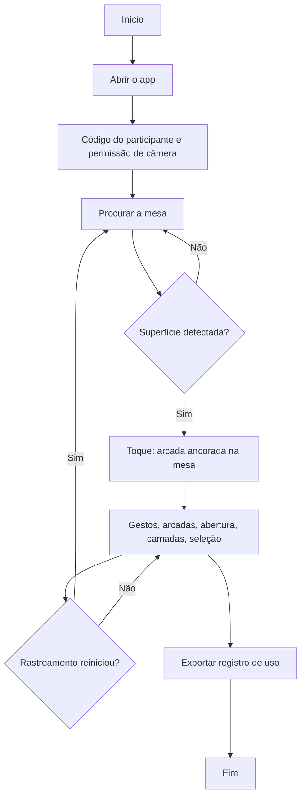

---

## 19. Caso de Uso

Fonte: [`docs/diagrams/caso-de-uso.md`](docs/diagrams/caso-de-uso.md).

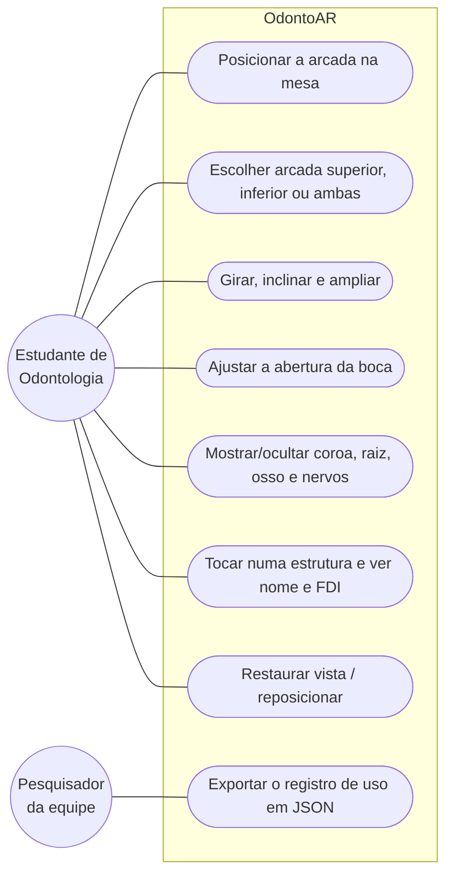

---

## 20. Fluxo de Navegação

Fonte: [`docs/diagrams/navegacao.md`](docs/diagrams/navegacao.md).

```text
Abertura
    ↓
Código do participante
    ↓
Permissão de câmera
    ↓
Procurando superfície → Superfície detectada
    ↓ (toque)
Visualização da arcada ──→ Cartão da estrutura (toque num dente)
    │                  ──→ Ajuda e créditos (?)
    │                  ──→ Registro de uso (relógio) → Exportar JSON
    └── Reposicionar → Procurando superfície
```

Na segunda abertura, com código e câmera salvos, o app vai direto para "Procurando superfície".

---

## 21. Interface

As imagens abaixo são prévias das telas geradas no Editor pelo menu `OdontoAR/Gerar prévias da
interface` (`UIPreview.cs`), com fundo neutro no lugar da imagem da câmera. No aparelho, o fundo é a
câmera e a arcada aparece sobre a mesa (seção 25).

| Tela | Finalidade | Principais elementos | Ação do usuário |
|---|---|---|---|
| 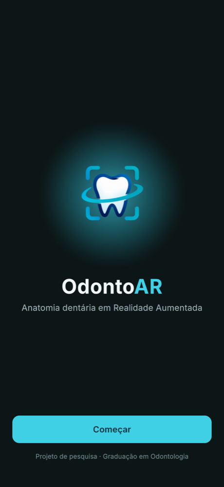 | **Abertura** — apresenta o app | Símbolo, nome, botão Começar | Tocar em Começar |
| 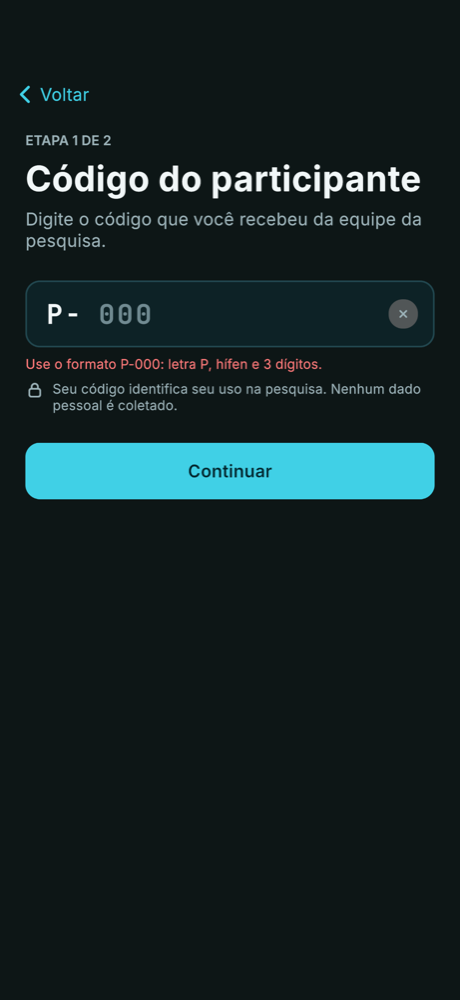 | **Código do participante** — identifica a sessão sem dados pessoais | Campo do código, botão Continuar | Digitar o código |
| 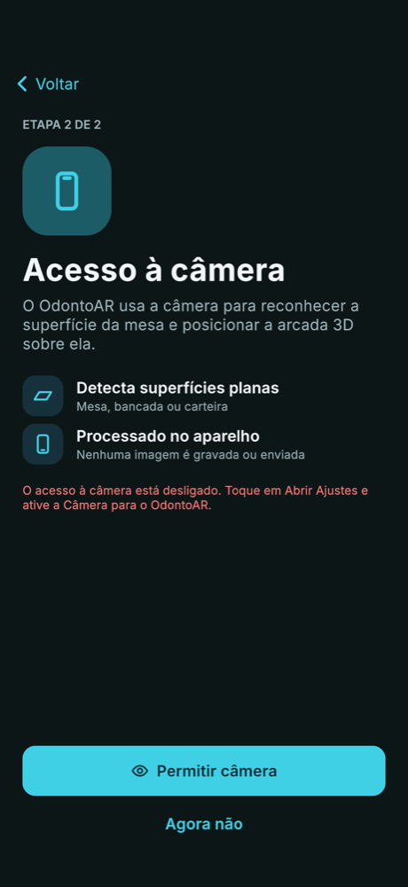 | **Permissão de câmera** — explica por que a câmera é usada | Texto, botão Permitir câmera | Autorizar a câmera |
| 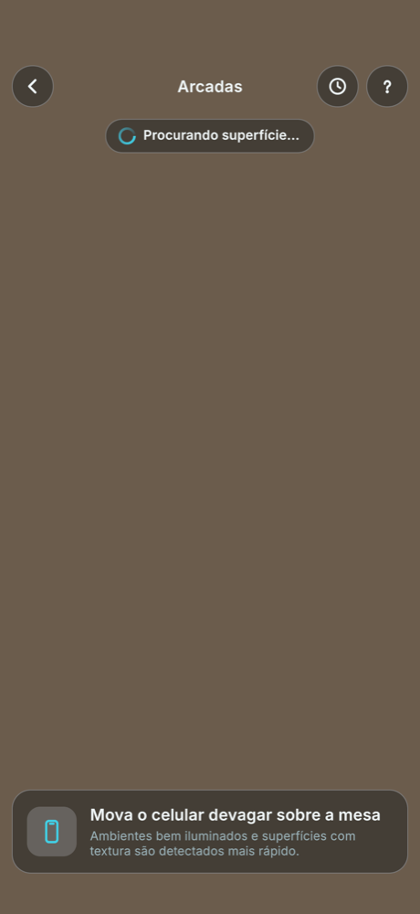 | **Procurando superfície** — guia a detecção da mesa | Mensagem de orientação | Mover o iPhone sobre a mesa |
| 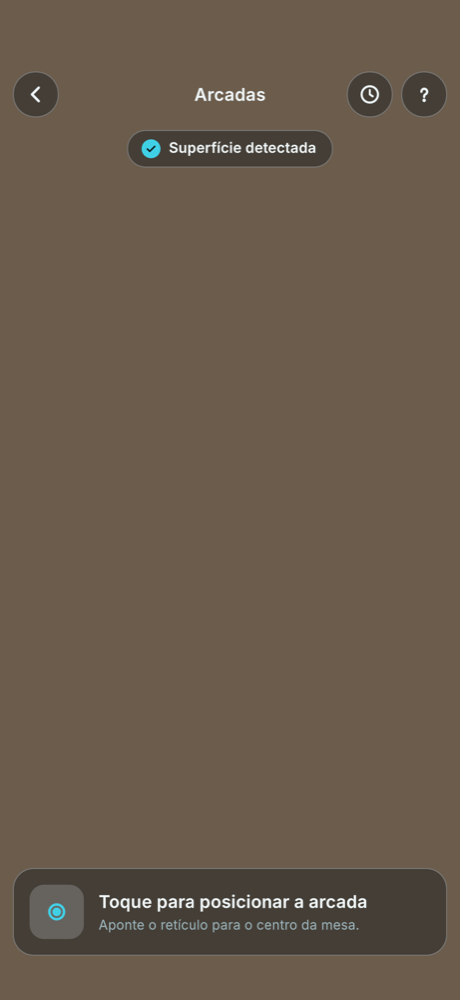 | **Superfície detectada** — confirma onde a arcada vai nascer | Retículo, "Toque para posicionar a arcada" | Tocar na mesa |
| 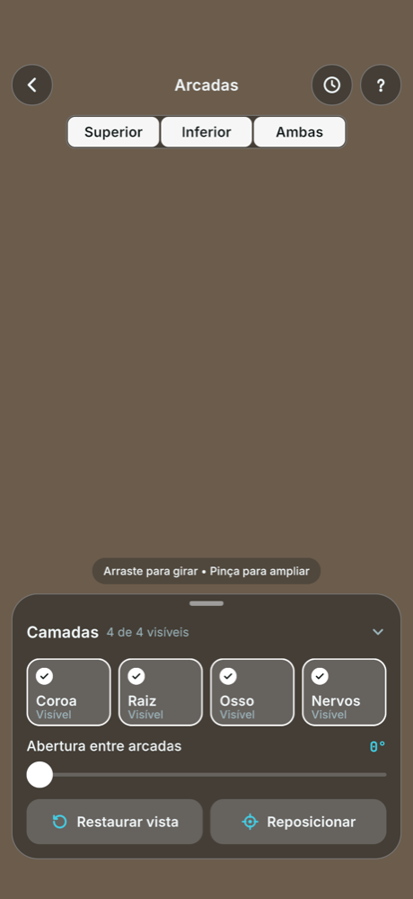 | **Visualização** — explorar a arcada | Barra superior, seletor de arcada, abertura, Restaurar/Reposicionar, painel de camadas | Gestos, trocar arcada e camadas |
| 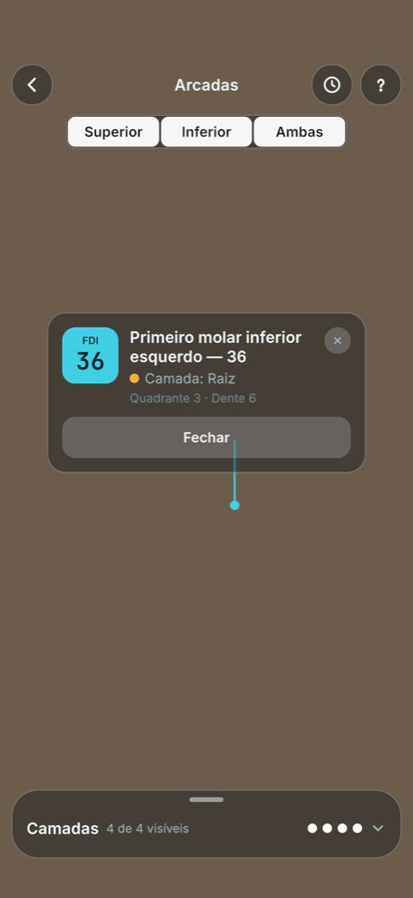 | **Cartão da estrutura** — identifica o que foi tocado | Código FDI, nome, camada, quadrante | Ler e fechar |
| 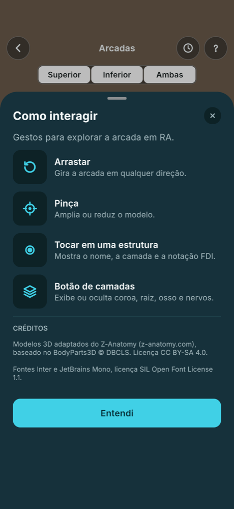 | **Ajuda** — gestos e créditos | Lista de gestos, créditos do Z-Anatomy | Ler e tocar em Entendi |
| 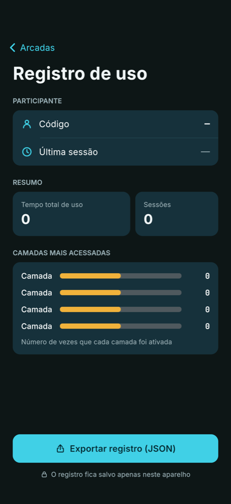 | **Registro de uso** — resumo para a pesquisa | Tempo, sessões, camadas, Exportar | Exportar o JSON |

---

## 22. Testes Técnicos

### 22.1 Testes automatizados

126 testes EditMode (Unity Test Framework) cobrindo `ModelState` (limites de escala e abertura,
camadas, seleção, restaurar vista), tradução FDI, nomes das estruturas, código do participante e
formato do registro JSON. Última execução: **126/126 passando** (26/10/2026). Além disso,
`ModelValidator` confere o modelo 3D (todos os dentes com FDI, coroa, raiz e collider).

### 22.2 Testes no aparelho (iPhone 16 Pro Max, durante o desenvolvimento)

| Teste | Procedimento | Resultado esperado | Resultado obtido | Status |
|---|---|---|---|---|
| Instalação | Build por terminal e `devicectl install` | App instala e abre | Instalou e abriu, sem a tela do Unity | ✅ |
| Permissão de câmera | Primeira abertura, Permitir câmera | Aviso do iOS e câmera ativa | Funcionou | ✅ |
| Detecção da mesa (RF02) | Apontar para a mesa | Retículo e "Superfície detectada" | Detectado | ✅ |
| Posicionamento (RF01) | Tocar com o retículo visível | Arcada em tamanho real sobre a mesa | Exibida, de frente e nivelada | ✅ |
| Arcadas (RF03) e abertura (RF06) | Trocar arcada e arrastar o slider | Arcada escolhida; abre 0°–30° | Funcionou | ✅ |
| Zoom (RF05) e restaurar (RF07) | Pinça e Restaurar vista | 0,5×–4×; volta ao padrão | Funcionou | ✅ |
| Camadas (RF08) | Ligar e desligar cada camada | Camada some e volta, transparência | Funcionou | ✅ |
| Seleção (RF09) | Tocar em 11, 36, 43, maxila, mandíbula | Contorno e cartão com nome e FDI | Funcionou | ✅ |
| Registro (RF10) | Usar 2 min e exportar por AirDrop | JSON com sessões e eventos | JSON exportado e conferido | ✅ |
| Oclusão | Passar a mão na frente da arcada | A mão cobre a arcada | Funcionou | ✅ |
| Desempenho (RNF02) | Todas as camadas ligadas, contador de FPS | ≥ 30 FPS | 60 médio, pior quadro ~31 | ✅ |
| Privacidade (RNF07) | Abrir o JSON exportado | Só código, datas e eventos | Sem dados pessoais | ✅ |
| Estabilidade (RNF03) | Andar em volta da mesa | Arcada presa à mesa | Ainda "nada" um pouco com o movimento | 🚧 |
| Rastreamento reiniciado | Cobrir a câmera / superfície lisa | Aviso e volta à busca da mesa | Implementado; falta registrar no checklist | 🚧 |

O checklist completo da verificação do sistema (funcionais, interação, estabilidade por superfície e
luz, desempenho, compatibilidade, RNFs, revisão do especialista e piloto com colegas) está em
[`docs/documents/TESTES.md`](docs/documents/TESTES.md) e está sendo preenchido.

---

## 23. Dispositivos Testados

| Dispositivo | Sistema | LiDAR | Resultado |
|---|---|---|---|
| Apple iPhone 16 Pro Max | iOS 27.0.1 | Sim | Compatível: fluxo completo, oclusão e 60 FPS |

Ainda não testado em iPhone sem LiDAR nem em Android; não declaramos compatibilidade com eles.

---

## 24. Limitações Conhecidas

- **Só iOS:** a POC não roda em Android (falta configurar o ARCore e testar).
- **Estabilidade:** a arcada ainda "nada" levemente quando o iPhone se move, embora os logs mostrem a
  âncora fixa no mundo; a causa está em investigação.
- **Superfícies lisas e pouca luz:** o ARKit pode demorar a detectar a mesa ou reiniciar o
  rastreamento; o app avisa e pede para posicionar de novo.
- **Sem LiDAR não há oclusão:** a mão não esconde a arcada; o resto funciona.
- **Modelo anatômico:** sem polpa e sem terceiros molares (ausentes no Z-Anatomy); a revisão por um
  especialista (RNF06) ainda não foi feita.
- **Instalação:** fora da App Store; com conta Apple gratuita o app expira em **7 dias** e precisa ser
  reinstalado pelo Mac.
- **Testes com pessoas:** o piloto com colegas e o 2º aparelho ainda estão pendentes.

---

## 25. Evidências de Funcionamento

- Prévias das telas: seção 21 e pasta [`docs/images/`](docs/images/).
- Modelo 3D renderizado: [`docs/images/modelo-3d.png`](docs/images/modelo-3d.png).
- Testes automatizados: 126/126 (seção 22.1).
- Captura de tela no iPhone 16 Pro Max (iOS 27.0.1), abaixo.

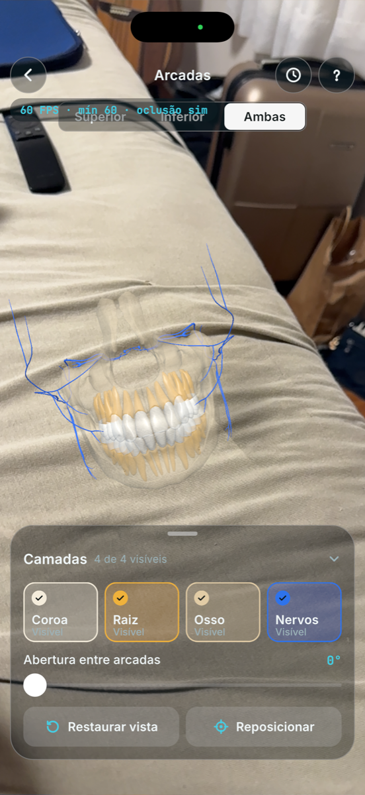

*Arcada posicionada sobre uma superfície real, com as duas arcadas e as quatro camadas visíveis: coroa e
raiz translúcidas, osso alveolar e nervos (em azul). No canto superior, o contador de diagnóstico
(toque com 3 dedos) mostra 60 FPS, pior quadro 60 e oclusão com LiDAR ligada.*

---

## 26. Repositórios e Recursos

| Recurso | Link |
|---|---|
| Código-fonte | [github.com/viniciusalegre20/OdontoAR](https://github.com/viniciusalegre20/OdontoAR) |
| Plano de implementação | [`docs/documents/PLANO.md`](docs/documents/PLANO.md) |
| Histórico e próximos passos | [`docs/documents/HISTORICO.md`](docs/documents/HISTORICO.md) |
| Modelo 3D (origem) | [Z-Anatomy](https://www.z-anatomy.com/) |
| Documentação do AR Foundation 6.x | [docs.unity3d.com/Packages/com.unity.xr.arfoundation@6.0](https://docs.unity3d.com/Packages/com.unity.xr.arfoundation@6.0/manual/index.html) |

---

## 27. Cronograma Técnico

Uma tarefa por vez, com critérios de aceite em [`PLANO.md`](docs/documents/PLANO.md).

| Atividade | Responsável | Status |
|---|---|---|
| Organização das sprints, backlog e acompanhamento do cronograma | Guilherme Dias | 🚧 |
| T0 — Projeto Unity 6 (URP) do zero e auditoria | Vinicius Alegre de Oliveira | ✅ |
| T1 — AR Foundation + ARKit e configuração iOS por script | Vinicius Alegre de Oliveira, Leonardo Vergilio Luz | ✅ |
| T2 — Build iOS por linha de comando | Vinicius Alegre de Oliveira | ✅ |
| T3 — Cena de RA: plano, retículo, posicionar, gestos, sombra | Leonardo Vergilio Luz, Vinicius Alegre de Oliveira | ✅ |
| T4 — `ModelState`, seletor de arcada e abertura | Leonardo Vergilio Luz | ✅ |
| T5 — Mapeamento FDI, colliders e validador do modelo | Leonardo Vergilio Luz | ✅ |
| T6 — Camadas coroa, raiz, osso e nervos | Leonardo Vergilio Luz | ✅ |
| T7 — Seleção por toque e cartão FDI | Leonardo Vergilio Luz, Bruno Carvalho | ✅ |
| T8 — Interface do design system, ícone e tela de abertura | Bruno Carvalho | ✅ |
| T9 — Registro de uso e exportação | Vinicius Alegre de Oliveira | ✅ |
| T10 — Oclusão com LiDAR | Leonardo Vergilio Luz | ✅ |
| T11 — Verificação do sistema e estabilidade | Equipe (coordenação: Guilherme Dias) | 🚧 |
| Revisão do modelo por especialista | Guilherme Dias | ⬜ |
| Vídeo demo, artigo e apresentação (23–30/11) | Equipe (coordenação: Guilherme Dias) | ⬜ |

---

## 28. Controle de Versão

- Repositório: `viniciusalegre20/OdontoAR`, branch `main`.
- **Um commit por tarefa**, com mensagem em português que diz o que mudou, prefixada pela tarefa
  (`T3:`, `T9:`) ou pelo tipo (`Docs:`, `PLANO:`). Exemplos reais do histórico:

```text
T0: cria projeto Unity do zero com estrutura _OdontoAR
T3: corrige build no Xcode (sandbox, assinatura e geração do zero)
T7: seleção por toque, contorno e cartão FDI
T9: registro de uso em JSON, tela de registro e exportação pelo iOS
T11: posicionamento com âncora de mundo e diagnóstico da deriva
```

- Cena, prefab e `ProjectSettings` são gerados por scripts de Editor, então as mudanças ficam legíveis
  no código e não só em arquivos `.unity`.

---

## 29. Problemas Encontrados e Soluções

### Problema 1 — Arcada "andando com a câmera"

**Problema:** depois de posicionada, a arcada às vezes saía do lugar e parecia acompanhar o iPhone.
**Causa:** com pouca textura ou pouca luz (`InsufficientFeatures`) o ARKit reinicia o mundo e descarta
as âncoras; a âncora presa ao plano também sumia quando dois planos da mesa se fundiam.
**Solução:** âncora de mundo em vez de âncora no plano; detecção da âncora perdida e volta para a busca
da mesa com aviso; mira só em planos já detectados (o "plano estimado" errava a altura). Uma deriva
leve ainda está em investigação (seção 24).

### Problema 2 — Link do IL2CPP falhando no Xcode

**Problema:** o build iOS quebrava no link com símbolos indefinidos.
**Causa:** o projeto estava em `~/Documents`, sincronizado pelo iCloud, que criava cópias
"arquivo 2.cpp" durante o build; o build em modo "append" mantinha restos.
**Solução:** projeto movido para `~/Developer` e build do Xcode sempre gerado do zero.

### Problema 3 — Tela de permissão errada

**Problema:** o app pedia a câmera mesmo já autorizada (ou não pedia).
**Causa:** `Application.HasUserAuthorization` do Unity não reflete a permissão real do iOS.
**Solução:** plugin nativo `OdontoARCamera.mm` que consulta o AVFoundation.

### Problema 4 — Arcada inclinada sobre a mesa

**Problema:** a arcada aparecia torta, de lado.
**Causa:** o modelo do Z-Anatomy vem 14,3° fora do plano oclusal; nivelar pelo centro dos dentes
corrigia só 5°.
**Solução:** plano oclusal calculado por mínimos quadrados nas pontas das cúspides.

### Problema 5 — Tela de abertura do Unity no iOS

**Problema:** aparecia o logo padrão do Unity em vez do símbolo do app.
**Causa:** faltava a imagem de paisagem e o storyboard do Unity escondia o logo.
**Solução:** imagens de retrato e paisagem e um storyboard próprio aplicado no pós-processamento.

Lista completa em [`HISTORICO.md`](docs/documents/HISTORICO.md#4-problemas-resolvidos).

---

## 30. Melhorias Futuras e Documentos Complementares

### Melhorias futuras

- eliminar a deriva da arcada e concluir a verificação (T11);
- versão Android com ARCore (o código já usa AR Foundation);
- modelo validado por especialista, com polpa e terceiros molares;
- distribuição por TestFlight (exige o Apple Developer Program pago);
- estudo com alunos usando o registro de uso.

### Documentos em `docs/documents/`

| Documento | Conteúdo |
|---|---|
| [`PLANO.md`](docs/documents/PLANO.md) | Plano de implementação (T0–T11) com critérios de aceite |
| [`HISTORICO.md`](docs/documents/HISTORICO.md) | O que foi feito, decisões, problemas resolvidos e próximos passos |
| [`TESTES.md`](docs/documents/TESTES.md) | Checklist de verificação do sistema |
| [`INSTALACAO.md`](docs/documents/INSTALACAO.md) | Ambiente em outro Mac e instalação em outro iPhone |
| [`AUDITORIA.md`](docs/documents/AUDITORIA.md) | Estado inicial do projeto e do modelo 3D |
| [`CREDITOS.md`](docs/documents/CREDITOS.md) | Atribuições (Z-Anatomy, fontes) |

---

## 31. Custos e Recursos

| Recurso | Tipo | Custo/Condição |
|---|---|---|
| Unity 6 | Software | Gratuito (licença Personal) |
| Xcode | Software | Gratuito |
| Conta Apple (Personal Team) | Serviço | Gratuita; app expira em 7 dias |
| Modelo Z-Anatomy | Conteúdo | Gratuito, CC BY-SA 4.0 (atribuição obrigatória) |
| Fontes Inter e JetBrains Mono | Conteúdo | Gratuitas, SIL OFL 1.1 |
| Mac e iPhone 16 Pro Max | Hardware | Equipamentos da equipe |

---

## 32. Licença

Projeto acadêmico desenvolvido para fins educacionais na disciplina UPX — Realidade Aumentada da
Facens. Os modelos 3D são adaptados do Z-Anatomy (BodyParts3D © DBCLS) sob **CC BY-SA 4.0**; as
fontes Inter e JetBrains Mono estão sob **SIL OFL 1.1**. Detalhes em
[`CREDITOS.md`](docs/documents/CREDITOS.md).

---

## 33. Autores

- **Vinicius Alegre de Oliveira** (RA 211902) — tech lead
- **Guilherme Dias** (RA 235128) — Scrum Master
- **Leonardo Vergilio Luz** (RA 234674) — desenvolvedor Unity
- **Bruno Carvalho** (RA 235537) — desenvolvedor UI/UX

**Equipe:** Aura Works
**Instituição:** Facens
**Disciplina:** UPX — Realidade Aumentada
**Curso:** Engenharia da Computação · **Professor:** Daniel Ohata
**Semestre:** 8º semestre (2026.2)
