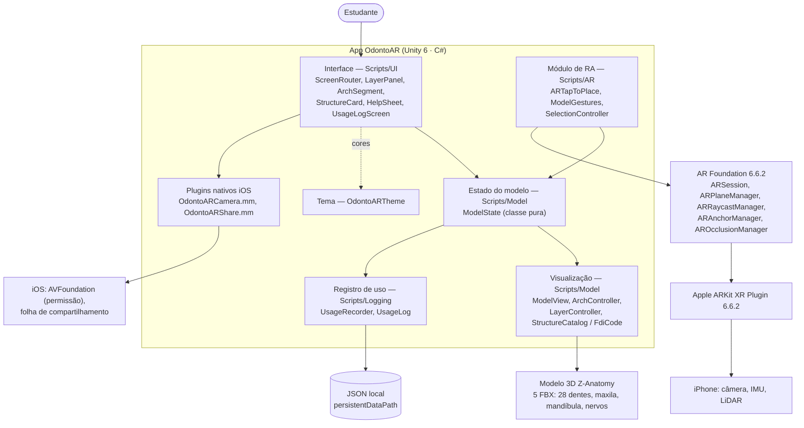

# Arquitetura do OdontoAR

Diagrama em Mermaid (o GitHub desenha automaticamente). Mesmo diagrama da seção 10 do `README.md`.

Não há servidor, API nem banco de dados: o app funciona offline e grava o registro de uso só no aparelho.
